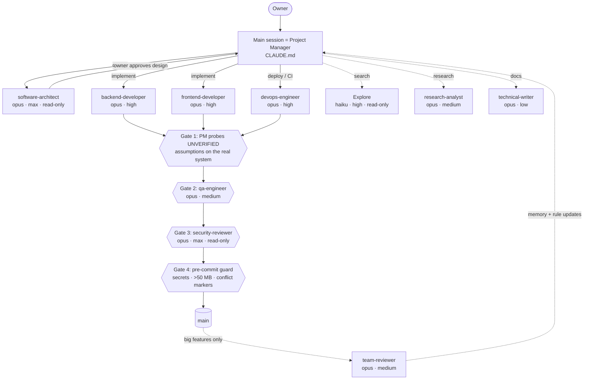

# Claude Code agent team

A reusable [Claude Code](https://docs.claude.com/en/docs/claude-code) setup: nine specialized subagents plus
a read-only search agent, each pinned to its own model and reasoning effort, six skills, safety hooks,
permission rules for several sessions sharing one working tree, and a git pre-commit guard.
It exists because a single general-purpose agent is expensive, reviews its own work, and happily commits
secrets or switches branches under a parallel session. This template splits writing from judging, routes
each role to the cheapest model that does it well, and puts hard guards where a prompt rule is not enough.

## The team and the review gates



Hooks run on every tool call underneath: protected files cannot be edited, `git commit` is scanned for
secrets, C#/TypeScript edits get a build/type check, and `git checkout` / `switch` / `stash` are denied.

## What's inside

| Path | What |
|---|---|
| `CLAUDE.md` | Rulebook template for the main session: delegation, verification, git, token economics |
| `.claude/agents/` | 10 subagents — architect, backend, frontend, QA, security reviewer, DevOps, research, technical writer, team reviewer, Explore |
| `.claude/skills/` | `team-workflow`, `learn-from-correction`, `team-retrospective`, `aspnet-controller`, `aspnet-feature-bundle`, `ef-migration` |
| `.claude/hooks/` | `block-protected-files`, `secret-scan`, `dotnet-build-check`, `tsc-check`, `notify-windows`, optional `branch-guard` (PowerShell) |
| `.claude/settings.json` | Hook wiring + allow/deny permission rules |
| `githooks/` | Git pre-commit guard (Python stdlib + a small sh wrapper) |
| `tests/` | Guard tests, hook tests, static config tests |
| `docs/` | Design notes |

## Quickstart (about 5 minutes)

```bash
# 1. Copy the template into your repository
cp -r claude-code-agent-team/.claude claude-code-agent-team/githooks your-repo/
cp claude-code-agent-team/CLAUDE.md your-repo/        # or merge it into your existing CLAUDE.md

# 2. Turn on the pre-commit guard (needs Python 3.8+ on PATH)
cd your-repo
git config core.hooksPath githooks

# 3. Edit the stack lists in CLAUDE.md and .claude/agents/*.md to match your defaults
# 4. Start Claude Code in the repo; /agents lists the team
```

The hooks are PowerShell, invoked as `powershell -File "$CLAUDE_PROJECT_DIR/.claude/hooks/…"`. On macOS/Linux
install PowerShell 7 and replace `powershell` with `pwsh` in `.claude/settings.json`, or drop the hooks you
don't need (`notify-windows` is Windows-only).

## Tests and CI

```bash
python -m unittest discover -s tests -v                                   # guard + config tests
powershell -NoProfile -ExecutionPolicy Bypass -File tests/hooks.Tests.ps1 # hook tests (Windows)
```

- `tests/test_pre_commit_guard.py` builds a throwaway repo per test, installs the hook and checks that it
  refuses each of the 7 secret patterns, a 51 MB file and conflict markers, also through the temporary index of
  `git commit -- <paths>`, and that it allows a clean commit and does not re-flag an old secret already in history.
- `tests/hooks.Tests.ps1` feeds each hook the JSON Claude Code sends and checks exit code / output (22 cases).
- `tests/test_config.py` checks that every agent pins a valid model and effort, the reviewers have no write
  tools, every wired hook script exists, and the branch-switching deny rules are present.
- `.github/workflows/ci.yml` runs the Python tests on Ubuntu and Windows and the hook tests under Windows
  PowerShell 5.1 and PowerShell 7.

All fake secrets in the tests are assembled by string concatenation, so the repository itself never matches
a secret scanner (the guard runs on this repository's own commits).

## Design decisions

- **Model and effort per role, pinned in frontmatter.** Max effort only for the architect and the security
  reviewer (rare, high stakes); Haiku only for read-only search. → [docs/model-routing.md](docs/model-routing.md)
- **"Verified" means a command and its real output**, and the check must be able to fail.
  → [docs/verification.md](docs/verification.md)
- **Writers and judges are separate**; the security reviewer cannot edit; panels of parallel agents with
  different angles for decisions that need more than one view. → [docs/adversarial-review.md](docs/adversarial-review.md)
- **Several sessions, one working tree:** the checkout stays on main, commits name their paths, features go
  to worktrees and merge fast-forward only. → [docs/parallel-sessions.md](docs/parallel-sessions.md)
- **Cost ≈ turns × context:** no polling, scheduled checks as scripts, subagents to keep raw data out of the
  main context. → [docs/token-economics.md](docs/token-economics.md)
- **Two layers against secrets:** the `secret-scan` hook stops Claude's own `git commit`; the git guard stops
  every commit, including a human's. An internal error in the guard lets the commit through: a broken guard
  must not block work.

## Limitations

- Hooks are PowerShell and were developed on Windows; macOS/Linux need `pwsh` and the command change above.
- Deny rules match command prefixes Claude Code sees; they do not stop a human, an alias, or a script that runs
  git internally.
- Pattern-based secret detection misses secrets with no recognizable prefix (generic passwords, custom tokens).
  Use a dedicated scanner and your host's push protection as well.
- The guard skips the commit if Python is missing (by design), and `git commit --no-verify` bypasses it.
- The hook JSON contract (`hookSpecificOutput`, exit code 2 = block) follows the Claude Code docs at the time
  of writing; the tests check the scripts' outputs, not a live Claude Code session.
- The ASP.NET skills assume Minimal APIs, EF Core and xUnit.
- CI has not run yet on GitHub; it was only parsed locally.

## How this was built

Built with AI coding agents (Claude Code), which wrote most of the code and prompts.
The author, Ciprian Tuzaru, owned the architecture (the roles, the model routing, the gates), the review
process and the verification. This repository is a cleaned-up extract of the setup he uses daily.

What was verified, and how:
- **Pre-commit guard:** `python -m unittest discover -s tests` — 11 tests pass. Negative control: with the size
  limit raised to 100 MB and one pattern broken, the suite fails on exactly those two cases.
- **Hooks:** `tests/hooks.Tests.ps1` — 22/22 pass under Windows PowerShell 5.1. Negative control: with
  `block-protected-files` changed to exit 0, 7 cases fail.
- **`dotnet-build-check`:** run by hand against a real project with the .NET 10 SDK: a clean file produces no
  output, a syntax error returns the compiler errors. This also exposed a bug in the original hook (it read a
  stale exit code and reported a clean build as failed); fixed here.
- **Settings and CI:** `settings.json` loads as JSON and every hook it wires exists (`tests/test_config.py`);
  `ci.yml` parses as YAML. CI itself is unverified until the first push.
- **Content:** the repository and its git history were searched for personal paths, hostnames, tokens and
  private project names before publishing.
